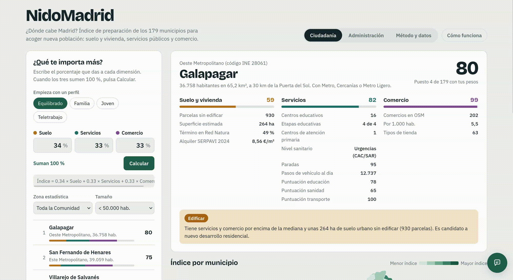
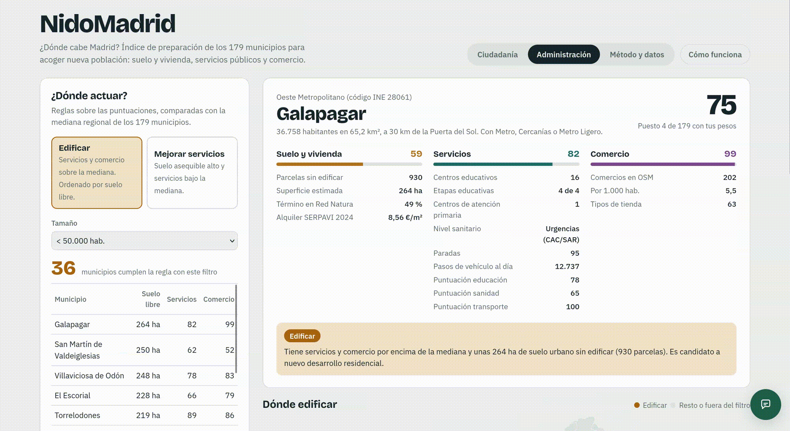
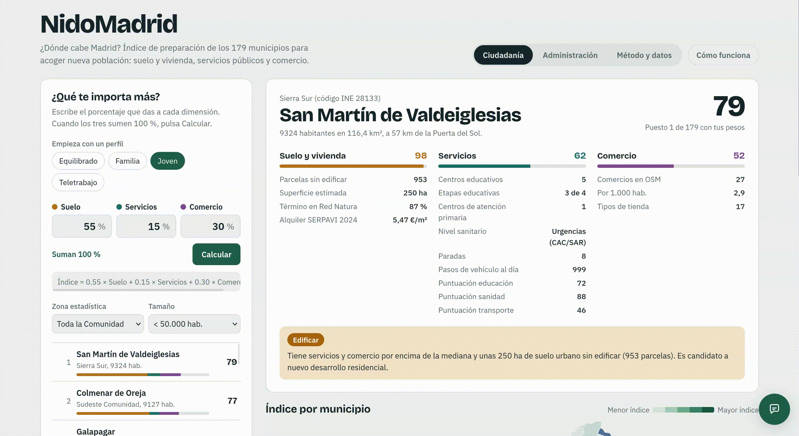

# NidoMadrid · ¿Dónde cabe Madrid?

Índice de preparación de los **179 municipios de la Comunidad de Madrid** para acoger nueva población,
según tres dimensiones: **suelo y vivienda**, **servicios públicos** (educación, sanidad y transporte) y
**comercio**. Construido con datos abiertos, calculado íntegramente en **Oracle Autonomous AI Database** y
publicado como una web ligera sobre **Oracle Cloud Infrastructure (OCI)**.

**Segundo premio** en II datathon LoDCOREMadrid, octubre de 2026.

<!-- GIF: vista general de la web (mapa + ranking + ficha) -->

**Web:** [enlace a la web](https://objectstorage.eu-madrid-1.oraclecloud.com/n/axqrwjvfmhla/b/nidomadrid-web/o/index.html)

---

## Ciudadanía

Cada persona reparte 100 puntos entre las tres dimensiones, o parte de un perfil (Equilibrado, Familia, Joven, Teletrabajo), y pulsa **Calcular**. Oracle devuelve el ranking ponderado, el mapa se colorea por quintiles y cada municipio tiene una ficha con sus datos. 

<!-- GIF: cambiar pesos o perfil, pulsar Calcular y ver cómo cambia el ranking -->

## Administración

Clasifica cada municipio con reglas sobre la mediana regional:

- **Edificar:** servicios y comercio por encima de la mediana. Puede crecer ya. Se ordena por suelo sin edificar disponible.
- **Mejorar servicios:** suelo por encima de la mediana, pero servicios por debajo. La web indica qué servicio falta: educación, sanidad o transporte.

<!-- GIF: pestaña Administración, cambiar de modo y abrir un municipio -->

## Pregunta a los datos

Una burbuja en la esquina inferior derecha permite preguntar en lenguaje natural («¿Qué municipios de menos de 20.000 habitantes tienen hospital?»). Oracle convierte la pregunta en SQL con **Select AI**, la ejecuta sobre la misma vista que usa la web y redacta la respuesta, mostrando el SQL ejecutado para poder comprobarlo. 

<!-- GIF: abrir la burbuja, hacer una pregunta y desplegar "Ver el SQL" -->

## Método y datos

Una pestaña con las fuentes, las reglas de cálculo y la descarga de todos los indicadores en CSV. La primera visita muestra además una guía breve de uso, que se puede volver a abrir con **Cómo funciona**.
